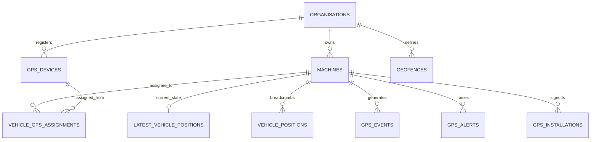

# MachineCare GPS Tracking — Database & Security Architecture (Phase 4)

## 1. Overview & Data Philosophy

The **MachineCare GPS Tracking** module is architected as an independent solution suite running on top of Supabase PostgreSQL and Node.js ingestion daemons. It is strictly multi-tenant: every vehicle, position, geofence, alert, and hardware device is bound to an `organisation_id`.



---

## 2. Relational Schema & Entity Specifications

### A. `gps_devices` (Hardware Registry)
* **Purpose**: Tracks telematics hardware units (Teltonika, Concox, Jimi IoT, Queclink, Coban, Suntech).
* **Key Columns**:
  * `id` (`UUID PRIMARY KEY DEFAULT gen_random_uuid()`)
  * `organisation_id` (`UUID NOT NULL REFERENCES organisations(id) ON DELETE CASCADE`)
  * `imei` (`TEXT NOT NULL`): 15-digit hardware IMEI with Luhn checksum verification
  * `name` (`TEXT NOT NULL`): Friendly identifier / vehicle tag
  * `manufacturer` (`TEXT NOT NULL DEFAULT 'Teltonika'`)
  * `model` (`TEXT NOT NULL DEFAULT 'FMC920'`)
  * `protocol` (`TEXT NOT NULL DEFAULT 'teltonika'`): Protocol decoder (`teltonika`, `gt06`, `coban`, `suntech`, `queclink`)
  * `traccar_device_id` (`INTEGER`): Device ID in Traccar backend
  * `sim_phone_number` (`TEXT`), `sim_carrier` (`TEXT DEFAULT 'Vodacom TZ'`)
  * `status` (`TEXT NOT NULL DEFAULT 'unassigned'`): `active` | `unassigned` | `suspended` | `offline` | `decommissioned`
  * `last_communication_at` (`TIMESTAMPTZ`): Last ping received from satellite/cellular link
* **Constraints**:
  * `CONSTRAINT uq_gps_devices_org_imei UNIQUE (organisation_id, imei)`

### B. `vehicle_gps_assignments` (Assignment & Audit Trail)
* **Purpose**: Records historical and active pairings between GPS devices and fleet vehicles.
* **Key Columns**:
  * `id` (`UUID PRIMARY KEY`)
  * `organisation_id` (`UUID NOT NULL REFERENCES organisations(id)`)
  * `device_id` (`UUID NOT NULL REFERENCES gps_devices(id)`)
  * `vehicle_id` (`UUID NOT NULL REFERENCES machines(id)`)
  * `installed_at` (`TIMESTAMPTZ NOT NULL DEFAULT now()`)
  * `removed_at` (`TIMESTAMPTZ`): NULL while active; populated upon replacement or unassignment
  * `technician_name` (`TEXT`), `technician_phone` (`TEXT`)
  * `installation_location` (`TEXT DEFAULT 'Under Dashboard / OBD'`)
  * `installation_notes` (`TEXT`)
  * `status` (`TEXT NOT NULL DEFAULT 'active'`): `active` | `historical` | `decommissioned`
* **Invariant Constraint**:
  * Partial unique index: A physical device can NEVER be actively assigned to multiple vehicles at the same time:
    ```sql
    CREATE UNIQUE INDEX idx_gps_assign_unique_active_device 
    ON public.vehicle_gps_assignments(device_id) 
    WHERE status = 'active';
    ```

### C. `latest_vehicle_positions` (Fast Live Map Cache)
* **Purpose**: Single latest state per vehicle for instant live fleet rendering without scanning millions of historical breadcrumbs.
* **Key Columns**:
  * `vehicle_id` (`UUID PRIMARY KEY REFERENCES machines(id)`)
  * `device_id` (`UUID REFERENCES gps_devices(id)`)
  * `organisation_id` (`UUID NOT NULL REFERENCES organisations(id)`)
  * `latitude` (`NUMERIC(10, 7) NOT NULL`), `longitude` (`NUMERIC(10, 7) NOT NULL`)
  * `speed_kmh` (`NUMERIC(6, 2) NOT NULL DEFAULT 0`)
  * `heading` (`NUMERIC(5, 2) NOT NULL DEFAULT 0`)
  * `altitude` (`NUMERIC(7, 2) DEFAULT 0`)
  * `ignition` (`BOOLEAN DEFAULT false`)
  * `battery_voltage` (`NUMERIC(5, 2)`)
  * `external_power_connected` (`BOOLEAN DEFAULT true`)
  * `motion_status` (`TEXT CHECK (motion_status IN ('moving', 'idling', 'stopped', 'offline'))`)
  * `satellite_count` (`INTEGER DEFAULT 0`)
  * `accuracy_m` (`NUMERIC(6, 2)`)
  * `odometer_km` (`NUMERIC(10, 2)`)
  * `address` (`TEXT`)
  * `recorded_at` (`TIMESTAMPTZ NOT NULL`): Time GPS satellite fix was generated on device
  * `received_at` (`TIMESTAMPTZ NOT NULL DEFAULT now()`): Time server ingested packet

### D. `vehicle_positions` (High-Frequency Breadcrumb History)
* **Purpose**: High-frequency telemetry log used for Route Playback, journey analysis, speed profiles, and distance calculation.
* **Key Columns**:
  * `id` (`BIGINT GENERATED ALWAYS AS IDENTITY PRIMARY KEY`)
  * `organisation_id` (`UUID NOT NULL REFERENCES organisations(id)`)
  * `vehicle_id` (`UUID NOT NULL REFERENCES machines(id)`)
  * `latitude`, `longitude`, `speed_kmh`, `heading`, `altitude`, `ignition`, `odometer_km`, `battery_voltage`, `satellite_count`
  * `recorded_at` (`TIMESTAMPTZ NOT NULL`), `received_at` (`TIMESTAMPTZ NOT NULL`)
  * `raw_attributes` (`JSONB DEFAULT '{}'::jsonb`)

### E. `geofences` (Perimeters)
* **Purpose**: Geofenced zones (circles or polygons) with automated entry/exit event triggering.
* **Key Columns**:
  * `id` (`UUID PRIMARY KEY`)
  * `organisation_id` (`UUID NOT NULL`)
  * `name` (`TEXT NOT NULL`)
  * `geofence_type` (`circle` | `polygon`)
  * `center_latitude`, `center_longitude`, `radius_meters` (for circles)
  * `polygon_coordinates` (`JSONB` array of `[lat, lon]` points for polygons)
  * `speed_limit_kmh` (`NUMERIC(6,2)`)
  * `entry_alert` (`BOOLEAN`), `exit_alert` (`BOOLEAN`), `active` (`BOOLEAN`)

### F. `gps_events` & `gps_alerts`
* **Purpose**: Actionable notifications and immutable audit events (`overspeed`, `power_cut`, `low_battery`, `geofence_enter`, `geofence_exit`, `device_offline`).
* Supports acknowledgment workflow (`is_acknowledged`, `acknowledged_at`, `acknowledged_by`, `notes`).

### G. `gps_installations` (Technician Installation Sign-Off)
* **Purpose**: Formal digital commission record: wiring notes, customer contact, photos, ignition sense verification, and antenna placement.

---

## 3. High-Performance Indexing Strategy

To guarantee sub-second dashboard and map queries across large enterprise fleets:

| Table | Index Name | Index Columns | Query Optimization Target |
| :--- | :--- | :--- | :--- |
| `vehicle_positions` | `idx_positions_org_veh_time` | `(organisation_id, vehicle_id, recorded_at DESC)` | Route replay and date-range slicing |
| `latest_vehicle_positions` | `idx_latest_pos_org` | `(organisation_id)` | Live fleet map instant load |
| `latest_vehicle_positions` | `idx_latest_pos_motion` | `(motion_status)` | Fleet status filtering (moving/idling/stopped) |
| `gps_alerts` | `idx_gps_alerts_org_unack_time`| `(organisation_id, is_acknowledged, event_time DESC)`| Real-time alerts notification drawer |
| `gps_devices` | `idx_gps_devices_org_status` | `(organisation_id, status)` | Unassigned stock vs active fleet filters |
| `vehicle_gps_assignments`| `idx_gps_assign_unique_active_device`| `(device_id) WHERE status = 'active'` | Enforces 1 active vehicle per tracker |
| `geofences` | `idx_geofences_org_active` | `(organisation_id, active)` | Ingestion alert evaluator cache |

---

## 4. Multi-Tenant Row-Level Security (RLS)

All 8 GPS tables enforce PostgreSQL Row-Level Security. Unprivileged clients cannot access records outside their authenticated tenant.

### Core Policy Logic:
1. **Tenant Isolation**:
   ```sql
   CREATE POLICY "org members can view vehicle positions"
   ON public.vehicle_positions FOR SELECT
   TO authenticated
   USING (organisation_id = public.current_org_id());
   ```
2. **Write Authorization**:
   ```sql
   CREATE POLICY "org writers can insert vehicle positions"
   ON public.vehicle_positions FOR INSERT
   TO authenticated
   WITH CHECK (public.can_write(organisation_id));
   ```
3. **Privileged Backend Ingestion**:
   * The Node.js daemon connects via the Supabase `service_role` key over a private VPS network.
   * Privileged service-role bypasses RLS for high-throughput batch writes while explicitly setting the verified `organisation_id` mapped from the registered vehicle.

---

## 5. Security & Regulatory Compliance (Tanzania / LATRA)

1. **Read-Only Telematics Safety**:
   * In initial releases, remote engine cut / relay immobilization is strictly disabled in code. The system provides read-only monitoring and tracking to comply with vehicle safety standards.
2. **Driver Privacy**:
   * Telematics data is restricted to authorized fleet controllers within the organization. Driver phone numbers and identity documents are stored under encrypted multi-tenant storage.
3. **LATRA (Land Transport Regulatory Authority) Readiness**:
   * Continuous data logging with preserved device satellite fix timestamps (`recorded_at`).
   * Overspeed event detection calibrated to commercial vehicle speed limits (80 km/h for heavy trucks, 100 km/h for intercity buses).
